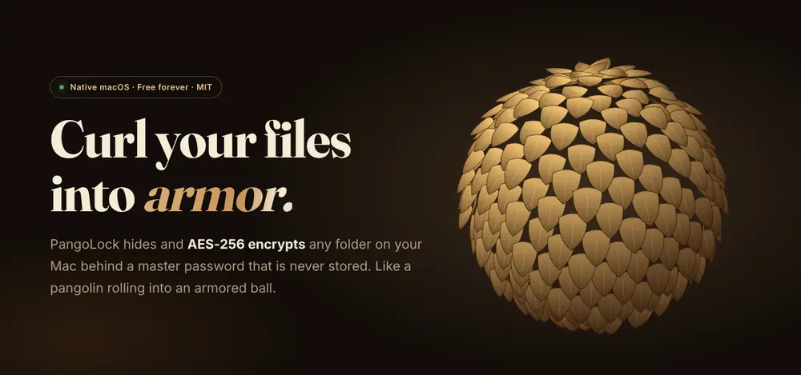
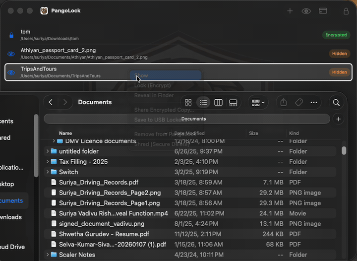
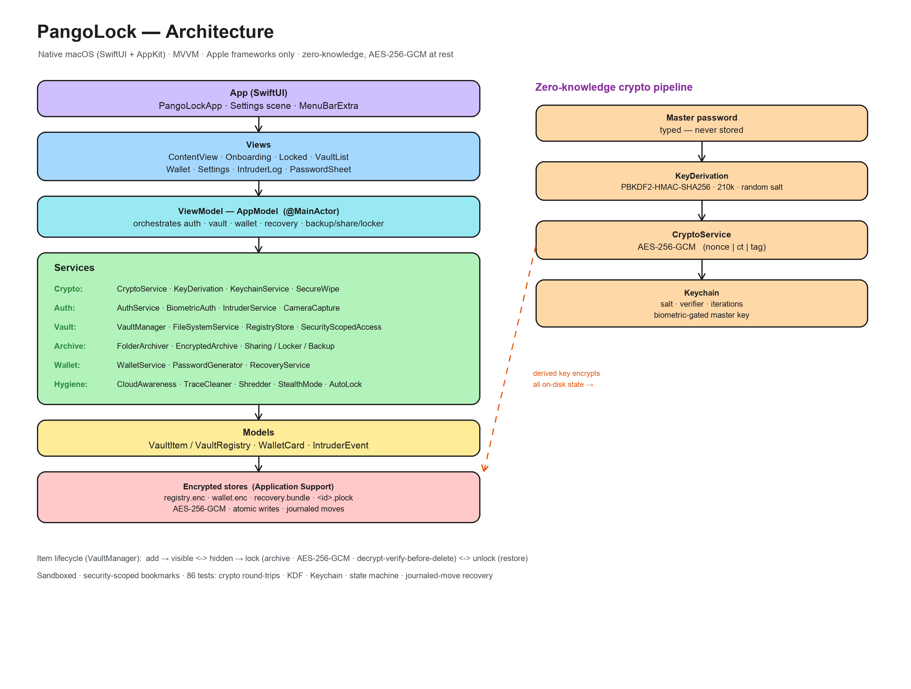

<div align="center">

<a href="https://suriya4code.github.io/PangoLock/"></a>

# PangoLock

**Hide and password-lock any folder on your Mac — like a pangolin curling into an armored ball.**

[](https://suriya4code.github.io/PangoLock/)

[](https://github.com/suriya4code/PangoLock/actions/workflows/ci.yml)
[](LICENSE)
[](#requirements)
[](#requirements)
[](SECURITY.md)
[](SECURITY.md)

**100% free & open source. Every feature. No paywall, no premium tier, no account.**

[**Website**](https://suriya4code.github.io/PangoLock/) · [**Build from source**](#build--run) · [**Security model**](SECURITY.md) · [**Architecture**](docs/ARCHITECTURE.md) · [**Sponsor**](https://github.com/sponsors/suriya4code)

<br />



</div>

---

PangoLock is a native macOS app that hides and **AES‑256 encrypts** your private
folders and files behind a master password — with a zero‑knowledge design where
your password is never stored and your data is encrypted at rest.

## Hide vs. Lock

| | 🙈 **Hide** | 🔒 **Lock** |
|---|---|---|
| **What it does** | Removes the item from Finder, strips all permissions (`chmod 000`) and adds a Spotlight skip marker | Encrypts it with AES‑256‑GCM into a managed `.plock` blob, verifies the result, then removes the plaintext |
| **Who can't reach it** | Finder, video players, media scanners, search | Anyone without your password |
| **Strength** | Strong against ordinary apps, **not encryption** | **The real defense** — use it for anything sensitive |
| **Undo** | Show restores everything | Unlock decrypts and restores to the original path |

## Features

<table>
<tr>
<td width="33%" valign="top">

### 🔒 Lock & encrypt
Unlimited folders with **AES‑256‑GCM**; optional per‑folder password.

</td>
<td width="33%" valign="top">

### 🙈 Hide & show
Gone from Finder **and** other apps: permissions stripped (`chmod 000`), Spotlight skipped. Show restores everything.

</td>
<td width="33%" valign="top">

### 🔑 Zero‑knowledge
Master password never stored (PBKDF2‑210k); **Touch ID** unlock; idle auto‑lock.

</td>
</tr>
<tr>
<td valign="top">

### 🧯 Fail‑safe
Verify‑before‑delete, atomic writes, journaled moves: an interrupted operation never loses data.

</td>
<td valign="top">

### 🛟 Recovery & backups
**Recovery key** for a forgotten password, **encrypted backups**, and **export everything** so deleting the app never strands your data.

</td>
<td valign="top">

### 💳 Encrypted wallet
Logins, cards, notes & licenses, with a strong‑password generator.

</td>
</tr>
<tr>
<td valign="top">

### 💾 Portable & shareable
USB lockers (`.pangolocker`) and encrypted sharing (`.pangoshare`, with a password hint).

</td>
<td valign="top">

### 🕵️ Intruder & stealth
Opt‑in **intruder snapshot** after failed unlocks, **stealth mode** (hide Dock icon), and **panic** lock‑&‑hide.

</td>
<td valign="top">

### 🧹 Shredder & cleaner
Secure shredder, trace cleaner, and **cloud‑awareness** warnings for iCloud/Dropbox/Drive/OneDrive paths.

</td>
</tr>
</table>

## Security

<p align="center">
  
</p>

PangoLock encrypts everything at rest with **AES‑256‑GCM**, derives keys with
**PBKDF2‑HMAC‑SHA256 (210,000 iterations)**, stores secrets in the macOS
**Keychain**, runs in the **App Sandbox**, and makes **no logging calls** that
could leak secrets. The full threat model — including what PangoLock does *not*
defend against — lives in **[SECURITY.md](SECURITY.md)**. Architecture details
are in **[docs/ARCHITECTURE.md](docs/ARCHITECTURE.md)**.

> Honest positioning: PangoLock protects your data **at rest** on your Mac. It is
> not a defense against a fully compromised or root‑level‑owned machine.

<details>
<summary><b>Architecture diagram</b></summary>
<br />



</details>

## Requirements

- macOS 13 (Ventura) or later — universal (Apple Silicon + Intel)
- Xcode 16+ / Swift 5.9+ to build from source

## Build & run

```bash
git clone https://github.com/suriya4code/PangoLock.git
cd PangoLock
xcodebuild build -project PangoLock.xcodeproj -scheme PangoLock \
  -configuration Debug -destination 'platform=macOS' \
  CODE_SIGNING_ALLOWED=NO -derivedDataPath build
open build/Build/Products/Debug/PangoLock.app
```

Run the tests:

```bash
xcodebuild test -project PangoLock.xcodeproj -scheme PangoLock \
  -destination 'platform=macOS' CODE_SIGNING_ALLOWED=NO -derivedDataPath build
```

For signing, notarization, and producing a release DMG, see
**[docs/RELEASING.md](docs/RELEASING.md)**.

## Contributing

Contributions are welcome! Please read **[CONTRIBUTING.md](CONTRIBUTING.md)**.
Security issues should be reported privately — see [SECURITY.md](SECURITY.md).

## Support the project

PangoLock is free forever. If it protects something you care about, please
**⭐ star the repo** and consider **[sponsoring](https://github.com/sponsors/suriya4code)**
to support ongoing development. Donations only — never a paywall.

## License

[MIT](LICENSE) © PangoLock contributors. The pangolin mascot/icon is part of this
project and shared under the same license.
